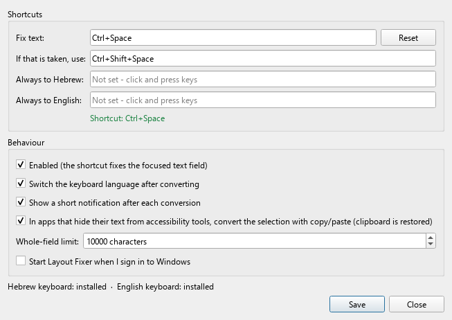

# Layout Fixer

Typed Hebrew while the keyboard was on English, or the other way round? Press **Ctrl+Space**: the text is converted
key-for-key to the other layout, replaced in place, and the input language is switched so you can keep typing.

```
typed (keyboard on English):   akuo' nv eurv?
after Ctrl+Space:              שלום, מה קורה?      ← and the keyboard is now Hebrew
```



*The real Settings window, rendered off-screen (`tools/render_screenshots.py`) with default settings and a demo
shortcut status. Native Windows styling differs slightly from this render.*

## Why it exists

Bilingual typists constantly type a sentence on the wrong layout. Retyping is slow, and online "fixers" mean pasting
private text into a website. Layout Fixer fixes the text where it is, in any app, entirely on your PC: no network,
no AI, no translation, no administrator rights.

## Features

- **One shortcut, both directions.** The direction comes only from the layout active in that window, never from
  guessing at the text. Press again to convert back.
- **Selection or whole field.** Converts only the selected text, or the whole focused field (up to 10,000 characters).
- **Most precise method per control:** Win32 edit messages for native text boxes (no clipboard, undoable), UI
  Automation for browsers, Electron, WPF, Qt and Office, and a clipboard fallback that backs up and restores your
  clipboard. Every write is read back and verified.
- **Safe by design:** never uses Ctrl+A, never pastes over embedded images, refuses password fields, terminals and
  elevated windows, and never logs your text (lengths and outcomes only).
- **Tray app** with a Settings window, a fallback shortcut when Ctrl+Space is taken, optional forced-direction
  shortcuts and start at login.
- **macOS port** with **⌘ + Fn** as the shortcut (Accessibility API, Quartz event tap). It is built on Windows and
  has not yet been run on a real Mac; see [README-macOS.md](README-macOS.md).

## Tech stack

Python · PySide6 (Qt Widgets) · `ctypes` (Win32: edit messages, keyboard layouts, clipboard, `RegisterHotKey`) ·
`comtypes` (UI Automation) · PyInstaller (one-file exe) · pytest + pytest-qt · macOS: PyObjC, py2app launcher stub.

## Requirements

- Windows 10 or 11, with the **Hebrew** and **English** keyboards installed for the language switch (conversion
  works without them).
- From source: **Python 3.14** (what the Windows build and tests use). The shared code also runs on Python 3.13,
  the version bundled in the macOS app.

## Install and run

Prebuilt binaries are not published yet, so build from source:

```bat
git clone https://github.com/fadlonerez-sketch/layoutfixer.git
cd layoutfixer
run.bat
```

`run.bat` creates `.venv` on first use (installing `requirements.txt`) and starts the tray app with no console
window. A blue **אA** icon appears in the tray; the first start opens Settings.

**Build the single-file exe** (`dist\LayoutFixer.exe`, about 31 MB):

```bat
py -3.14 -m venv .venv
.venv\Scripts\python -m pip install -r requirements-dev.txt
.venv\Scripts\python -c "import comtypes.client; comtypes.client.GetModule('UIAutomationCore.dll')"
.venv\Scripts\python -m PyInstaller --noconfirm --clean layoutfixer.spec
```

`build_exe.bat` does the same and also runs the full test suite (which uses hidden real windows and briefly
registers real hotkeys, Ctrl+Space included) and then starts the new exe for a self-test (`tools\verify_build.py`). The exe is not
code-signed, so SmartScreen or Smart App Control may block it; `run.bat` works either way.

**macOS:** `build_mac.bat` builds `dist\mac\LayoutFixer-macOS.zip` on Windows (details in
[README-macOS.md](README-macOS.md)). It is not published either and has not been run on a Mac yet.

Usage, supported apps, settings and troubleshooting: [docs/USAGE.md](docs/USAGE.md).

## Run the tests

```bat
.venv\Scripts\python -m pip install -r requirements-dev.txt
set QT_QPA_PLATFORM=offscreen
.venv\Scripts\python -m pytest tests/test_converter.py tests/test_mapping.py tests/test_clipboard_win32_logic.py tests/test_mac_keymap.py tests/test_mac_hotkeys.py tests/test_mac_env.py tests/test_engine.py tests/test_one_press.py tests/test_clipboard.py --deselect tests/test_engine.py::test_field_found_after_chromium_builds_its_accessibility_tree --deselect tests/test_engine.py::test_no_text_field_gives_up_after_the_settle_time --deselect tests/test_engine.py::test_focus_moving_elsewhere_stops_the_retries
.venv\Scripts\python -m ruff check .
```

Result on 2026-11-07 (Python 3.14.5): **197 passed, 1 skipped** (the skipped test is the opt-in real-clipboard
round trip). This is the pure and simulated set that CI runs, including the macOS logic with fakes.

`run_tests.bat` runs the full suite. It adds real-Windows tests: hidden Edit/RichEdit and Qt windows in separate
processes, real Chrome on a hidden desktop, keyboard-layout and hotkey-registration checks. See
[docs/TESTING.md](docs/TESTING.md) for what each part covers and the manual checklist.

## Project structure

```
layoutfixer/
  keymap.py, converter.py   physical key table (US/Hebrew) and strict key-for-key conversion (pure)
  engine.py                 one conversion end to end + dispatcher
  targets/                  native_edit (Win32 messages), uia_target (UI Automation), clipboard_target
  paste.py, clipboard.py    verified paste; clipboard backup/restore
  hotkeys.py                shortcut parsing, RegisterHotKey thread, fallback logic
  win/, win_env.py          ctypes APIs; picks the strategy for the focused control
  app.py, ui/               tray, Settings window, notification
  mac/                      macOS layer (event tap, Accessibility target, TIS layouts, pasteboard)
tests/                      pytest; tests/hosts/ are hidden test windows in separate processes
tools/                      build verification, macOS bundle builder/verifier, icon and screenshot renderers
```

## Known limitations

- In rich editors (Word, Gmail, Outlook) changed characters are pasted as plain text and take the formatting at that
  position.
- Without a selection, fields over the limit (default 10,000 characters) are refused rather than rewritten.
- Apps with custom-drawn text and no accessibility support (some games, remote desktop, Google Docs' canvas) work
  only through the selection fallback, or not at all.
- Ctrl+Space is a global registration: while Layout Fixer is enabled, other apps don't receive it (it can be
  changed, or the app disabled from the tray).
- Windows programs running as administrator can't be changed by a normal-privilege app.
- The exe is not code-signed; the macOS app is not signed or notarized.
- Pressing the real shortcut and real Ctrl+V into third-party apps are covered by a manual checklist, not by
  automated tests.

More detail: [docs/USAGE.md](docs/USAGE.md#troubleshooting).

## License

MIT. See [LICENSE](LICENSE). The macOS fallback key table is derived from Unicode CLDR data; see
[THIRD_PARTY_NOTICES.md](THIRD_PARTY_NOTICES.md).
